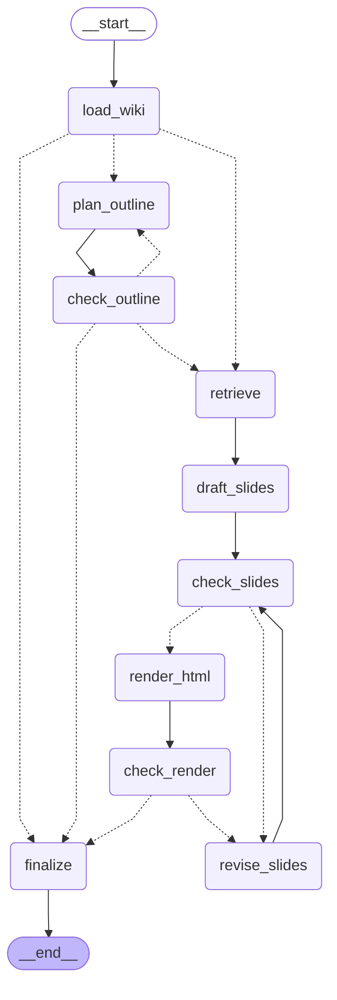

# 執行紀錄 20261113-000224

- 模式：只產生大綱（等待人工審閱）
- 結果：大綱通過閘門，等待人工審閱
- 總耗時：0.1 分鐘；LLM 呼叫 2 次；token 約 7,180

## 各節點統計

| 節點 | 執行次數 | LLM 呼叫 | token | 格式錯誤 | 限流等待 | 例外 | 被閘門退件 | 耗時（秒） |
|---|---|---|---|---|---|---|---|---|
| load_wiki | 1 | 0 | 0 | 0 | 0 | 0 | 0 | 0 |
| plan_outline | 2 | 2 | 7,180 | 0 | 0 | 0 | 1 | 7 |
| check_outline | 2 | 0 | 0 | 0 | 0 | 0 | 0 | 0 |

「被閘門退件」算在產生那份內容的節點頭上（大綱 → plan_outline；投影片 → draft_slides 或 revise_slides）。

## 閘門退件紀錄

### 1. 大綱閘門（產生者：plan_outline）
- **outline**
  - 第 8 頁 的標題要 1～16 字
  - 第 10 頁 的標題要 1～16 字
  - 第 17 頁 的標題要 1～16 字
  - 第 19 頁 的 pages 要列 1～3 個 Wiki 頁

## 投影片

| id | 類型 | 標題 | 最終分數 | 採用的版本 | 引用的 Wiki 頁 |
|---|---|---|---|---|---|
| s01 | cover | AI 代理設計模式簡介 | - | - |  |
| s02 | hook | AI 代理的崛起 | - | - | overview.md |
| s03 | concept | 什麼是 AI 代理 | - | - | concepts/workflow-vs-agent.md |
| s04 | concept | 代理式工作流程 | - | - | concepts/agentic-workflow.md |
| s05 | concept | 反思模式 | - | - | concepts/reflection.md |
| s06 | steps | 反思實作步驟 | - | - | concepts/self-refine.md |
| s07 | concept | 工具使用模式 | - | - | concepts/tool-use.md |
| s08 | steps | 工具使用步驟 | - | - | concepts/tool-use.md |
| s09 | concept | 規劃模式 | - | - | concepts/planning.md |
| s10 | steps | 規劃步驟 | - | - | concepts/planning.md |
| s11 | concept | 多代理協作 | - | - | concepts/multi-agent-collaboration.md |
| s12 | steps | 多代理流程 | - | - | concepts/multi-agent-collaboration.md |
| s13 | concept | 限制與風險 | - | - | concepts/agent-limitations.md |
| s14 | concept | 人在迴圈中 | - | - | concepts/human-in-the-loop.md |
| s15 | quiz | 小測驗：概念檢核 | - | - | concepts/reflection.md, concepts/tool-use.md, concepts/planning.md |
| s16 | compare | 代理 vs 工作流程 | - | - | concepts/workflow-vs-agent.md, concepts/agentic-workflow.md |
| s17 | quiz | 小測驗：限制與人因 | - | - | concepts/agent-limitations.md, concepts/human-in-the-loop.md |
| s18 | summary | 總結與未來展望 | - | - | overview.md |

## 流程圖

