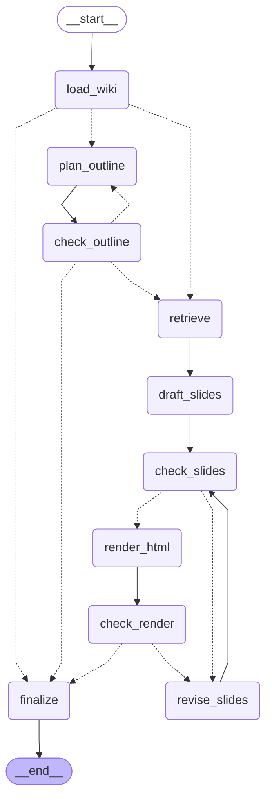

# 執行紀錄 20261113-000549

- 模式：產生完整簡報
- 結果：失敗：draft_slides：連續兩次輸出不是合法 JSON
- 總耗時：2.4 分鐘；LLM 呼叫 16 次；token 約 18,327

## 各節點統計

| 節點 | 執行次數 | LLM 呼叫 | token | 格式錯誤 | 限流等待 | 例外 | 被閘門退件 | 耗時（秒） |
|---|---|---|---|---|---|---|---|---|
| load_wiki | 1 | 0 | 0 | 0 | 0 | 0 | 0 | 0 |
| retrieve | 1 | 0 | 0 | 0 | 0 | 0 | 0 | 0 |
| draft_slides | 1 | 16 | 18,327 | 3 | 9 | 1 | 0 | 146 |

「被閘門退件」算在產生那份內容的節點頭上（大綱 → plan_outline；投影片 → draft_slides 或 revise_slides）。

## 閘門退件紀錄

（沒有退件）

## 投影片

| id | 類型 | 標題 | 最終分數 | 採用的版本 | 引用的 Wiki 頁 |
|---|---|---|---|---|---|
| s01 | cover | AI 代理設計模式 | - | - |  |
| s02 | hook | 同一題，誰的分數高？ | - | - | concepts/agentic-workflow.md |
| s03 | concept | 代理式工作流程 | - | - | concepts/agentic-workflow.md |
| s04 | concept | 四種招式一次看 | - | - | overview.md, concepts/agentic-workflow.md |
| s05 | concept | 反思：自己改作文 | - | - | concepts/reflection.md, concepts/self-refine.md |
| s06 | steps | 反思實作：心形圖貼文 | - | - | concepts/reflection.md, sources/tsai-2026-agent-notebooks.md |
| s07 | concept | 工具使用：帶計算機 | - | - | concepts/tool-use.md |
| s08 | steps | 麥茶 20 杯夠不夠？ | - | - | concepts/tool-use.md, sources/tsai-2026-agent-notebooks.md |
| s09 | concept | 規劃：出國排行程 | - | - | concepts/planning.md |
| s10 | steps | ReAct：想→做→看 | - | - | concepts/react.md |
| s11 | concept | 多代理：分組報告 | - | - | concepts/multi-agent-collaboration.md |
| s12 | compare | 跟團 vs. 自由行 | - | - | concepts/workflow-vs-agent.md |
| s13 | concept | 能簡單就簡單 | - | - | concepts/workflow-vs-agent.md, concepts/agentic-workflow.md |
| s14 | quiz | 小測驗：誰在執行？ | - | - | concepts/tool-use.md |
| s15 | concept | 代理也會出包 | - | - | concepts/agent-limitations.md, concepts/llm-feedback.md |
| s16 | concept | AI 做事，人來把關 | - | - | concepts/human-in-the-loop.md |
| s17 | quiz | 小測驗：該用代理嗎？ | - | - | concepts/workflow-vs-agent.md, concepts/agent-limitations.md |
| s18 | summary | 本章重點 | - | - | overview.md, concepts/workflow-vs-agent.md, concepts/human-in-the-loop.md |

## 流程圖

