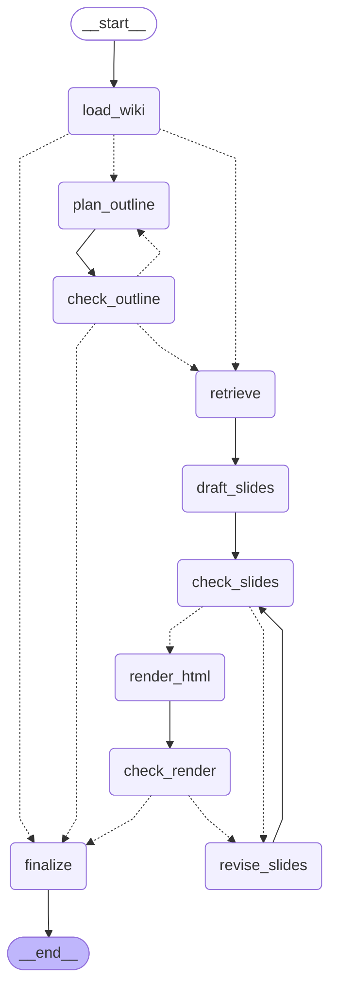

# 執行紀錄 20261113-001206

- 模式：產生完整簡報
- 結果：失敗：revise_slides：Groq 呼叫失敗
LLMError / HTTP -: An error occurred: Connection error.
APIConnectionError / HTTP -: Connection error.
ConnectError / HTTP -: [WinError 10054] 遠端主機已強制關閉一個現存的連線。
ConnectError / HTTP -: [WinError 10054] 遠端主機已強制關閉一個現存的連線。
ConnectionResetError / HTTP -: [WinError 10054] 遠端主機已強制關閉
- 總耗時：12.7 分鐘；LLM 呼叫 112 次；token 約 106,097

## 各節點統計

| 節點 | 執行次數 | LLM 呼叫 | token | 格式錯誤 | 限流等待 | 例外 | 被閘門退件 | 耗時（秒） |
|---|---|---|---|---|---|---|---|---|
| load_wiki | 1 | 0 | 0 | 0 | 0 | 0 | 0 | 0 |
| retrieve | 1 | 0 | 0 | 0 | 0 | 0 | 0 | 0 |
| draft_slides | 1 | 34 | 37,443 | 0 | 16 | 0 | 8 | 216 |
| check_slides | 2 | 52 | 42,852 | 0 | 28 | 0 | 0 | 313 |
| revise_slides | 2 | 26 | 25,802 | 0 | 16 | 1 | 6 | 235 |

「被閘門退件」算在產生那份內容的節點頭上（大綱 → plan_outline；投影片 → draft_slides 或 revise_slides）。

## 閘門退件紀錄

### 1. 投影片閘門（產生者：draft_slides）
- **s03**
  - analogy：66 字，超過上限 60 字，請精簡
- **s04**
  - definition：66 字，超過上限 60 字，請精簡
  - points：要 0～3 點
- **s05**
  - points[0]：52 字，超過上限 46 字，請精簡
  - points[1]：53 字，超過上限 46 字，請精簡
  - points[2]：51 字，超過上限 46 字，請精簡
- **s08**
  - steps[1]：62 字，超過上限 40 字，請精簡
  - steps[2]：42 字，超過上限 40 字，請精簡
  - steps[2]：數字 ['30', '30'] 在引用的 Wiki 頁裡找不到，請改成 Wiki 裡的數字或拿掉
- **s09**
  - analogy：63 字，超過上限 60 字，請精簡
  - points[1]：47 字，超過上限 46 字，請精簡
  - points[2]：57 字，超過上限 46 字，請精簡
- **s10**
  - steps[1]：59 字，超過上限 40 字，請精簡
  - steps[2]：44 字，超過上限 40 字，請精簡
- **s11**
  - definition：70 字，超過上限 60 字，請精簡
- **s15**
  - definition：82 字，超過上限 60 字，請精簡

### 2. 投影片閘門（產生者：revise_slides）
- **s05**
  - points[0]：50 字，超過上限 46 字，請精簡
  - points[1]：50 字，超過上限 46 字，請精簡
- **s08**
  - steps[1]：53 字，超過上限 40 字，請精簡
- **s09**
  - points[1]：47 字，超過上限 46 字，請精簡
- **s10**
  - steps[2]：44 字，超過上限 40 字，請精簡
- **s04**
  - points[3]：缺少多代理協作 (Multi-agent) 的招式說明，未完整呈現四種模式。 → 建議：在 points 陣列中加入一項：{"text": "多代理協作 Multi-agent：分角色合作、互相討論，穩定度較難預測。", "cite": ["overview.md"]}
- **s15**
  - points：缺少「自評有盲點」與「成本高」兩項限制，未完整對應規格 goal 中的四個要點。 → 建議：在 points 陣列中加入「自評有盲點：在專業領域 LLM 無法判斷自己的錯誤」以及「成本高：代理執行多步驟會產生較高的計算與 API 費用」的敘述，並引用同樣的 Wiki 頁面。

## 投影片

| id | 類型 | 標題 | 最終分數 | 採用的版本 | 引用的 Wiki 頁 |
|---|---|---|---|---|---|
| s01 | cover | AI 代理設計模式 | 1.0 | 第 1 輪 |  |
| s02 | hook | 同一題，誰的分數高？ | 1.0 | 第 0 輪 | concepts/agentic-workflow.md |
| s03 | concept | 代理式工作流程 | 0.95 | 第 1 輪 | concepts/agentic-workflow.md |
| s04 | concept | 四種招式一次看 | 0.825 | 第 1 輪 | overview.md, concepts/agentic-workflow.md |
| s05 | concept | 反思：自己改作文 | 0.0 | 第 1 輪 | concepts/reflection.md, concepts/self-refine.md |
| s06 | steps | 反思實作：心形圖貼文 | 1.0 | 第 0 輪 | concepts/reflection.md, sources/tsai-2026-agent-notebooks.md |
| s07 | concept | 工具使用：帶計算機 | 1.0 | 第 1 輪 | concepts/tool-use.md |
| s08 | steps | 麥茶 20 杯夠不夠？ | 0.0 | 第 1 輪 | concepts/tool-use.md, sources/tsai-2026-agent-notebooks.md |
| s09 | concept | 規劃：出國排行程 | 0.0 | 第 1 輪 | concepts/planning.md |
| s10 | steps | ReAct：想→做→看 | 0.0 | 第 1 輪 | concepts/react.md |
| s11 | concept | 多代理：分組報告 | 1.0 | 第 1 輪 | concepts/multi-agent-collaboration.md |
| s12 | compare | 跟團 vs. 自由行 | 1.0 | 第 1 輪 | concepts/workflow-vs-agent.md |
| s13 | concept | 能簡單就簡單 | 0.875 | 第 1 輪 | concepts/workflow-vs-agent.md, concepts/agentic-workflow.md |
| s14 | quiz | 小測驗：誰在執行？ | 0.975 | 第 1 輪 | concepts/tool-use.md |
| s15 | concept | 代理也會出包 | 0.825 | 第 1 輪 | concepts/agent-limitations.md, concepts/llm-feedback.md |
| s16 | concept | AI 做事，人來把關 | 1.0 | 第 1 輪 | concepts/human-in-the-loop.md |
| s17 | quiz | 小測驗：該用代理嗎？ | 0.9 | 第 1 輪 | concepts/workflow-vs-agent.md, concepts/agent-limitations.md |
| s18 | summary | 本章重點 | 0.938 | 第 1 輪 | overview.md, concepts/workflow-vs-agent.md, concepts/human-in-the-loop.md |

## 流程圖

