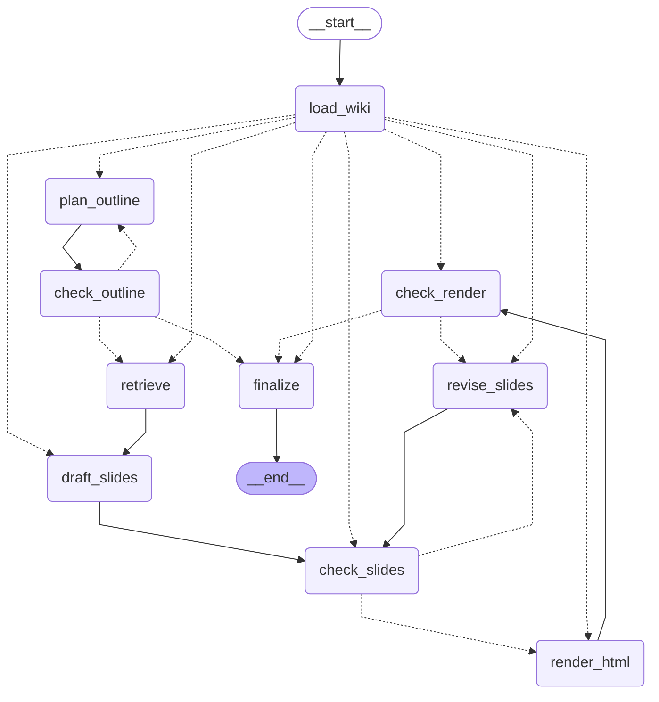

# 執行紀錄 20261113-002929

- 模式：產生完整簡報；從 20261113-001206 的 revise_slides 節點續跑
- 結果：簡報已產生，但有 4 頁未通過檢查，需人工處理
- 總耗時：2.6 分鐘；LLM 呼叫 18 次；token 約 27,291

## 各節點統計

| 節點 | 執行次數 | LLM 呼叫 | token | 格式錯誤 | 限流等待 | 例外 | 被閘門退件 | 耗時（秒） |
|---|---|---|---|---|---|---|---|---|
| load_wiki | 1 | 0 | 0 | 0 | 0 | 0 | 0 | 0 |
| revise_slides | 2 | 10 | 19,722 | 0 | 3 | 0 | 7 | 73 |
| check_slides | 2 | 8 | 7,569 | 0 | 4 | 0 | 0 | 58 |
| render_html | 2 | 0 | 0 | 0 | 0 | 0 | 0 | 0 |
| check_render | 2 | 0 | 0 | 0 | 0 | 0 | 0 | 27 |

「被閘門退件」算在產生那份內容的節點頭上（大綱 → plan_outline；投影片 → draft_slides 或 revise_slides）。

## 閘門退件紀錄

### 1. 投影片閘門（產生者：revise_slides）
- **s04**
  - points：要 0～3 點
- **s05**
  - points[0]：49 字，超過上限 46 字，請改寫到 36 字以內（刪掉修飾語或次要資訊，保留重點）
- **s08**
  - steps[1]：50 字，超過上限 46 字，請改寫到 36 字以內（刪掉修飾語或次要資訊，保留重點）
- **s15**
  - points：要 0～3 點

### 2. 版面閘門（產生者：revise_slides）
- **s04**
  - 版面：內容超出投影片 38px，請刪減字數或點數（不要刪掉 cite）
- **s13**
  - 版面：內容超出投影片 129px，請刪減字數或點數（不要刪掉 cite）

### 3. 投影片閘門（產生者：revise_slides）
- **s04**
  - points：缺少「多代理協作」的說明，Wiki 中列出四種招式，但投影片只列出三種。 → 建議：在 points 陣列中加入一項：{"text": "多代理協作：分角色合作、互相討論，穩定度較難預測。", "cite": ["overview.md"]}

## 投影片

| id | 類型 | 標題 | 最終分數 | 採用的版本 | 引用的 Wiki 頁 |
|---|---|---|---|---|---|
| s01 | cover | AI 代理設計模式 | 1.0 | 第 1 輪 |  |
| s02 | hook | 同一題，誰的分數高？ | 1.0 | 第 0 輪 | concepts/agentic-workflow.md |
| s03 | concept | 代理式工作流程 | 0.95 | 第 1 輪 | concepts/agentic-workflow.md |
| s04 | concept | 四種招式一次看 | 0.825 | 第 1 輪 | overview.md, concepts/agentic-workflow.md |
| s05 | concept | 反思：自己改作文 | 0.0 | 第 2 輪 | concepts/reflection.md, concepts/self-refine.md |
| s06 | steps | 反思實作：心形圖貼文 | 1.0 | 第 0 輪 | concepts/reflection.md, sources/tsai-2026-agent-notebooks.md |
| s07 | concept | 工具使用：帶計算機 | 1.0 | 第 1 輪 | concepts/tool-use.md |
| s08 | steps | 麥茶 20 杯夠不夠？ | 0.0 | 第 2 輪 | concepts/tool-use.md, sources/tsai-2026-agent-notebooks.md |
| s09 | concept | 規劃：出國排行程 | 0.912 | 第 2 輪 | concepts/planning.md |
| s10 | steps | ReAct：想→做→看 | 0.9 | 第 2 輪 | concepts/react.md |
| s11 | concept | 多代理：分組報告 | 1.0 | 第 1 輪 | concepts/multi-agent-collaboration.md |
| s12 | compare | 跟團 vs. 自由行 | 1.0 | 第 1 輪 | concepts/workflow-vs-agent.md |
| s13 | concept | 能簡單就簡單 | 0.9 | 第 3 輪 | concepts/workflow-vs-agent.md, concepts/agentic-workflow.md |
| s14 | quiz | 小測驗：誰在執行？ | 0.975 | 第 1 輪 | concepts/tool-use.md |
| s15 | concept | 代理也會出包 | 0.825 | 第 1 輪 | concepts/agent-limitations.md, concepts/llm-feedback.md |
| s16 | concept | AI 做事，人來把關 | 1.0 | 第 1 輪 | concepts/human-in-the-loop.md |
| s17 | quiz | 小測驗：該用代理嗎？ | 0.9 | 第 1 輪 | concepts/workflow-vs-agent.md, concepts/agent-limitations.md |
| s18 | summary | 本章重點 | 0.938 | 第 1 輪 | overview.md, concepts/workflow-vs-agent.md, concepts/human-in-the-loop.md |

## 流程圖

