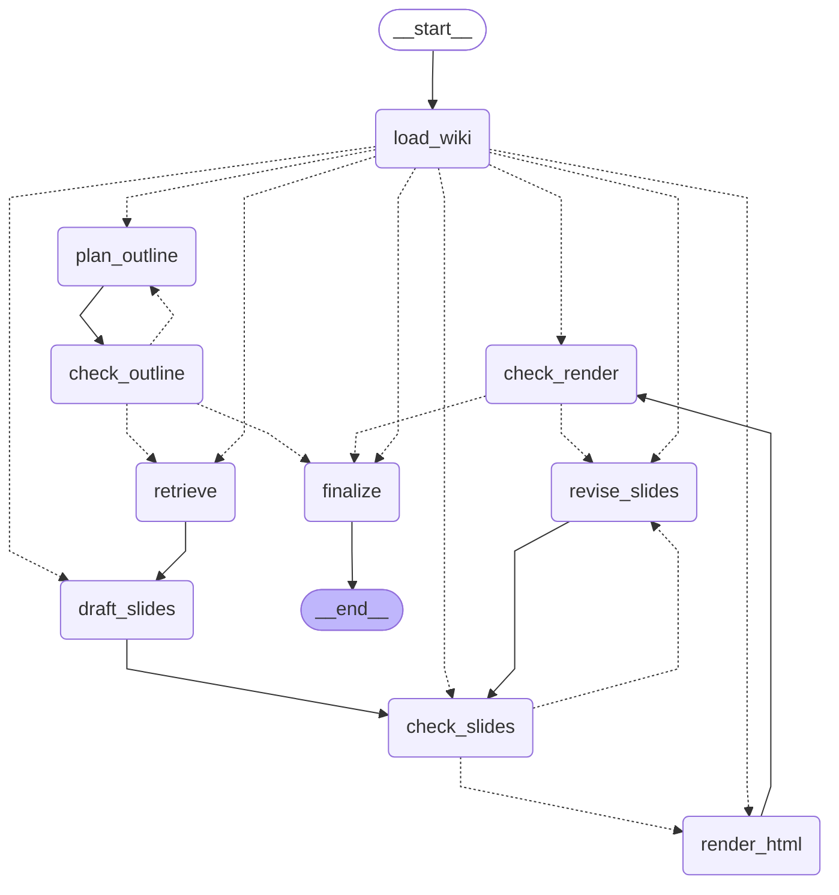

# 執行紀錄 20261113-024148

- 模式：產生完整簡報；從 20261113-002929 的 check_slides 節點續跑
- 結果：簡報已產生，全部頁面通過三個閘門
- 總耗時：1.1 分鐘；LLM 呼叫 11 次；token 約 15,182

## 各節點統計

| 節點 | 執行次數 | LLM 呼叫 | token | 格式錯誤 | 限流等待 | 例外 | 被閘門退件 | 耗時（秒） |
|---|---|---|---|---|---|---|---|---|
| load_wiki | 1 | 0 | 0 | 0 | 0 | 0 | 0 | 0 |
| check_slides | 3 | 5 | 8,895 | 0 | 2 | 0 | 0 | 26 |
| revise_slides | 2 | 6 | 6,287 | 0 | 4 | 0 | 3 | 27 |
| render_html | 1 | 0 | 0 | 0 | 0 | 0 | 0 | 0 |
| check_render | 1 | 0 | 0 | 0 | 0 | 0 | 0 | 13 |

「被閘門退件」算在產生那份內容的節點頭上（大綱 → plan_outline；投影片 → draft_slides 或 revise_slides）。

## 閘門退件紀錄

### 1. 投影片閘門（產生者：revise_slides）
- **s04**
  - points：要 0～2 點

### 2. 投影片閘門（產生者：revise_slides）
- **s04**
  - points：只列出「反思」與「工具使用」兩點，未說明「規劃」與「多代理協作」兩種模式，且未完整呈現四種模式的穩定度比較，未達到規格 goal「介紹四種模式，以及哪些比較穩定」 → 建議：在 points 中再加入兩點：
- 規劃 Planning：自行拆步驟、隨機應變，穩定度較難預測。
- 多代理協作 Multi‑agent：分角色合作、互相討論，穩定度較難預測。
每點的 cite 仍使用 ["overview.md"]，文字保持在 46 字以內。
  - definition：定義只說「Ng 2024 將 AI 代理分為四種招式」，未說明每種招式的核心功能，與 goal「介紹四種模式」的深度不足。 → 建議：將 definition 改為：「Ng 2024 將 AI 代理分為四種招式：反思（自行檢查、修改）、工具使用（計算機、上網查）、規劃（自行拆步驟、隨機應變）與多代理協作（分角色合作、互相討論）。」保持在 60 字以內，cite 仍為 ["overview.md"]。

### 3. 投影片閘門（產生者：revise_slides）
- **s04**
  - definition：75 字，超過上限 60 字，請改寫到 48 字以內（刪掉修飾語或次要資訊，保留重點）
  - points：要 0～2 點

## 投影片

| id | 類型 | 標題 | 最終分數 | 採用的版本 | 引用的 Wiki 頁 |
|---|---|---|---|---|---|
| s01 | cover | AI 代理設計模式 | 1.0 | 第 1 輪 |  |
| s02 | hook | 同一題，誰的分數高？ | 1.0 | 第 0 輪 | concepts/agentic-workflow.md |
| s03 | concept | 代理式工作流程 | 0.95 | 第 1 輪 | concepts/agentic-workflow.md |
| s04 | concept | 四種招式一次看 | 0.85 | 第 2 輪 | overview.md, concepts/agentic-workflow.md |
| s05 | concept | 反思：自己改作文 | 0.975 | 第 1 輪 | concepts/reflection.md, concepts/self-refine.md |
| s06 | steps | 反思實作：心形圖貼文 | 1.0 | 第 0 輪 | concepts/reflection.md, sources/tsai-2026-agent-notebooks.md |
| s07 | concept | 工具使用：帶計算機 | 1.0 | 第 1 輪 | concepts/tool-use.md |
| s08 | steps | 麥茶 20 杯夠不夠？ | 0.863 | 第 1 輪 | concepts/tool-use.md, sources/tsai-2026-agent-notebooks.md |
| s09 | concept | 規劃：出國排行程 | 0.912 | 第 2 輪 | concepts/planning.md |
| s10 | steps | ReAct：想→做→看 | 0.9 | 第 2 輪 | concepts/react.md |
| s11 | concept | 多代理：分組報告 | 1.0 | 第 1 輪 | concepts/multi-agent-collaboration.md |
| s12 | compare | 跟團 vs. 自由行 | 1.0 | 第 1 輪 | concepts/workflow-vs-agent.md |
| s13 | concept | 能簡單就簡單 | 0.9 | 第 3 輪 | concepts/workflow-vs-agent.md, concepts/agentic-workflow.md |
| s14 | quiz | 小測驗：誰在執行？ | 0.975 | 第 1 輪 | concepts/tool-use.md |
| s15 | concept | 代理也會出包 | 0.825 | 第 1 輪 | concepts/agent-limitations.md, concepts/llm-feedback.md |
| s16 | concept | AI 做事，人來把關 | 1.0 | 第 1 輪 | concepts/human-in-the-loop.md |
| s17 | quiz | 小測驗：該用代理嗎？ | 0.9 | 第 1 輪 | concepts/workflow-vs-agent.md, concepts/agent-limitations.md |
| s18 | summary | 本章重點 | 0.938 | 第 1 輪 | overview.md, concepts/workflow-vs-agent.md, concepts/human-in-the-loop.md |

## 流程圖

---

> **事後更正（2026-11-13，人工檢查時發現）**：上面的「結果」寫「全部頁面通過三個閘門」是**誤報**。
> 當時判斷狀態用的是**平均分數** ≥ 0.7，但投影片閘門的通過條件是「評審判定 pass，而且四項分數**最低**也要 ≥ 0.7」。
> s04 第 2 輪的版本平均 0.85，但 goal 只有 0.6、評審判定不通過（calls/007_check_slides.json）；
> s15 沿用的第 1 輪版本也是評審判定不通過的版本（runs/20261113-001206/check_round1.json）。
> 兩頁都是「大綱的 goal 列的項目比欄位上限放得下的多」，評審一直要求寫滿、修改又超出上限。
> 修正：保留最佳版本和最後狀態都改看「是否通過閘門」，評審和修改的提示加上 goal 與上限衝突時的規則，
> 再用 `python -m pipeline.recheck` 只重審 s04、s15。這段是事後加上的；上面是 pipeline 當時寫的原始紀錄，沒有改動。
