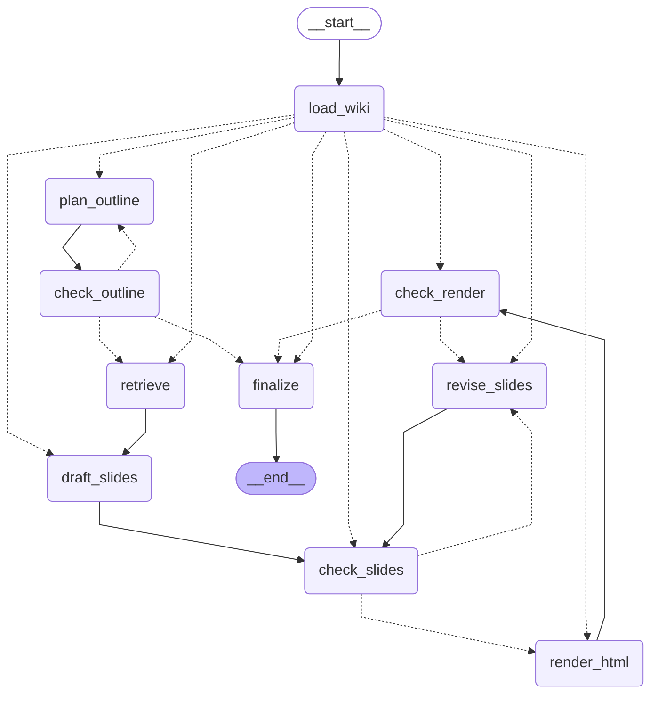

# 執行紀錄 20261113-024626

- 模式：產生完整簡報；從 20261113-024148 的 check_slides 節點續跑
- 結果：簡報已產生，全部頁面通過三個閘門
- 總耗時：0.8 分鐘；LLM 呼叫 6 次；token 約 12,835

## 各節點統計

| 節點 | 執行次數 | LLM 呼叫 | token | 格式錯誤 | 限流等待 | 例外 | 被閘門退件 | 耗時（秒） |
|---|---|---|---|---|---|---|---|---|
| load_wiki | 1 | 0 | 0 | 0 | 0 | 0 | 0 | 0 |
| check_slides | 2 | 4 | 9,457 | 0 | 1 | 0 | 0 | 29 |
| revise_slides | 1 | 2 | 3,378 | 0 | 1 | 0 | 1 | 5 |
| render_html | 1 | 0 | 0 | 0 | 0 | 0 | 0 | 0 |
| check_render | 1 | 0 | 0 | 0 | 0 | 0 | 0 | 13 |

「被閘門退件」算在產生那份內容的節點頭上（大綱 → plan_outline；投影片 → draft_slides 或 revise_slides）。

## 閘門退件紀錄

### 1. 投影片閘門（產生者：revise_slides）
- **s15**
  - points[1]：缺少「自評有盲點」的限制說明，未對應 Wiki 中的項目。 → 建議：加入一點說明，例如：「自評盲點：在專業領域，LLM 無法辨識自己的錯誤，評估結果可能不可靠。」並 cite 同一頁。
  - points[0]：未提及成本高的問題，只說明上下文限制。 → 建議：在第一點或新增點中加入成本相關描述，例如：「成本高：多步驟執行會產生大量 API 呼叫，費用隨錯誤累積而上升。」並 cite 同一頁。

## 投影片

| id | 類型 | 標題 | 最終分數 | 採用的版本 | 引用的 Wiki 頁 | 通過閘門 |
|---|---|---|---|---|---|---|
| s01 | cover | AI 代理設計模式 | 1.0 | 第 1 輪 |  | ✓ |
| s02 | hook | 同一題，誰的分數高？ | 1.0 | 第 0 輪 | concepts/agentic-workflow.md | ✓ |
| s03 | concept | 代理式工作流程 | 0.95 | 第 1 輪 | concepts/agentic-workflow.md | ✓ |
| s04 | concept | 四種招式一次看 | 1.0 | 第 1 輪 | overview.md, concepts/agentic-workflow.md | ✓ |
| s05 | concept | 反思：自己改作文 | 0.975 | 第 1 輪 | concepts/reflection.md, concepts/self-refine.md | ✓ |
| s06 | steps | 反思實作：心形圖貼文 | 1.0 | 第 0 輪 | concepts/reflection.md, sources/tsai-2026-agent-notebooks.md | ✓ |
| s07 | concept | 工具使用：帶計算機 | 1.0 | 第 1 輪 | concepts/tool-use.md | ✓ |
| s08 | steps | 麥茶 20 杯夠不夠？ | 0.863 | 第 1 輪 | concepts/tool-use.md, sources/tsai-2026-agent-notebooks.md | ✓ |
| s09 | concept | 規劃：出國排行程 | 0.912 | 第 2 輪 | concepts/planning.md | ✓ |
| s10 | steps | ReAct：想→做→看 | 0.9 | 第 2 輪 | concepts/react.md | ✓ |
| s11 | concept | 多代理：分組報告 | 1.0 | 第 1 輪 | concepts/multi-agent-collaboration.md | ✓ |
| s12 | compare | 跟團 vs. 自由行 | 1.0 | 第 1 輪 | concepts/workflow-vs-agent.md | ✓ |
| s13 | concept | 能簡單就簡單 | 0.9 | 第 3 輪 | concepts/workflow-vs-agent.md, concepts/agentic-workflow.md | ✓ |
| s14 | quiz | 小測驗：誰在執行？ | 0.975 | 第 1 輪 | concepts/tool-use.md | ✓ |
| s15 | concept | 代理也會出包 | 0.9 | 第 2 輪 | concepts/agent-limitations.md, concepts/llm-feedback.md | ✓ |
| s16 | concept | AI 做事，人來把關 | 1.0 | 第 1 輪 | concepts/human-in-the-loop.md | ✓ |
| s17 | quiz | 小測驗：該用代理嗎？ | 0.9 | 第 1 輪 | concepts/workflow-vs-agent.md, concepts/agent-limitations.md | ✓ |
| s18 | summary | 本章重點 | 0.938 | 第 1 輪 | overview.md, concepts/workflow-vs-agent.md, concepts/human-in-the-loop.md | ✓ |

## 流程圖

