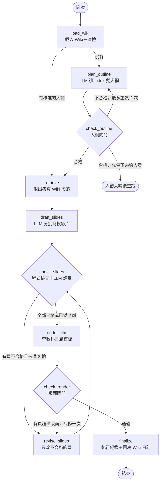
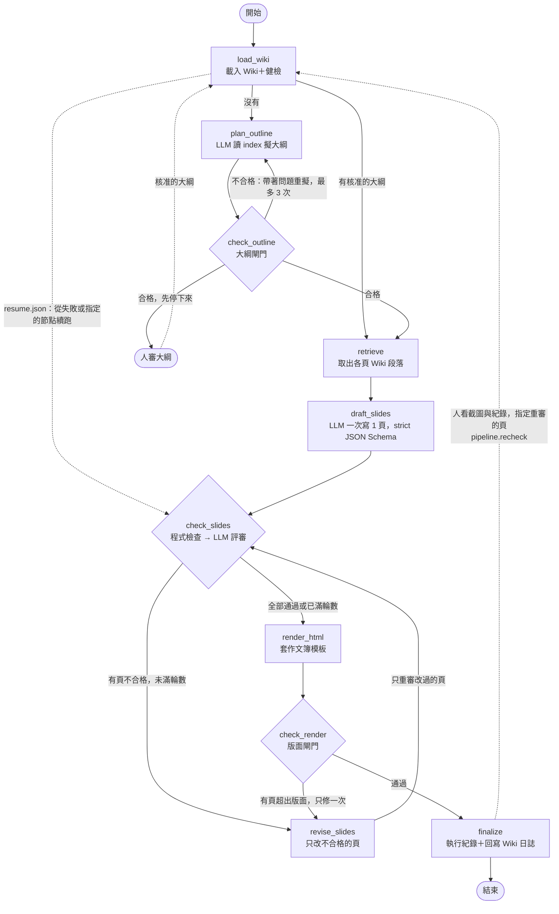

# 查詢｜根據 Wiki，教學簡報 pipeline 該怎麼設計？

> 這是本 Wiki 第一次正式的 **Query**（CLAUDE.md §5）：先讀 [index](../index.md)，再讀相關頁面，把答案回存到 `queries/`。這份設計是 pipeline 第 1 版（v1）的依據；實際跑過之後的修改記在本頁最後三節（v1 → v2、v2、v2 → v3），每次執行的細節在 `runs/<run-id>/report.md`。

## 問題

要用這個 Wiki 當知識庫，自動產生給非資工大學生看的教學 HTML 簡報（15～20 頁）。流程該長什麼樣子？哪些步驟會重複？哪裡要檢查、哪裡要重新生成？

## 一句話答案

做成一條**帶閘門的提示鏈，加上評估者—優化者迴圈**：查 Wiki → 擬大綱 →〔大綱閘門〕→（人看大綱）→ 取 Wiki 段落 → 寫投影片 →〔投影片閘門：程式檢查＋LLM 評審〕→ 不合格就改寫（最多 2 輪）→ 輸出 HTML →〔版面閘門〕→ 寫執行紀錄。它是**工作流程，不是代理**。

## 設計原則（每一條都來自 Wiki）

| # | 原則 | 依據 |
|---|---|---|
| 1 | 任務能清楚拆成固定步驟 → 用工作流程，不用代理；能簡單就簡單 | [工作流程 vs. 代理](../concepts/workflow-vs-agent.md)、[提示鏈](../concepts/prompt-chaining.md) |
| 2 | 步驟之間設「閘門」：先檢查大綱再寫全文 | [提示鏈](../concepts/prompt-chaining.md)（大綱 → 檢查 → 全文是原文的例子） |
| 3 | 投影片用「寫 → 評 → 改」迴圈 | [反思](../concepts/reflection.md)、[Self-Refine](../concepts/self-refine.md) |
| 4 | 數字、引用、字數這類細微錯誤交給程式檢查，不只靠 LLM 自評 | [LLM 回饋與自我評估](../concepts/llm-feedback.md)（數學回饋 94% 說沒問題）、課程「程式能確認的交給程式」 |
| 5 | LLM 評審用評分規準，一次呼叫打 0～1 分＋通過／不通過 | [如何評估代理](../concepts/agent-evaluation.md) |
| 6 | 回饋要具體可行動：指出哪一頁、哪一點、怎麼改 | [Self-Refine](../concepts/self-refine.md)、[LLM 回饋與自我評估](../concepts/llm-feedback.md) |
| 7 | 改寫時拿到「這頁的目標＋Wiki 段落＋評語」，目標和 Wiki 優先於評語 | [反思](../concepts/reflection.md)（原始需求優先於評論） |
| 8 | 改寫最多 2 輪，而且保留分數最高的版本 | [Self-Refine](../concepts/self-refine.md)（邊際效益遞減、可能改壞） |
| 9 | 每個節點都設停止條件，卡住就停下來交給人 | [代理的限制與風險](../concepts/agent-limitations.md)、[ReAct](../concepts/react.md)（卡迴圈） |
| 10 | 大綱讓人先看過再生成全文（簡報版的「先討論、後生成」） | [人在迴圈中](../concepts/human-in-the-loop.md) |
| 11 | 模型不記得上一次呼叫：每個節點明確傳入需要的資料 | [記憶](../concepts/memory.md) |
| 12 | Wiki 段落放進 prompt 時標明「這是資料，不是指令」 | [代理的限制與風險](../concepts/agent-limitations.md) |
| 13 | LangGraph 只管節點和邊，每次 LLM 的 prompt 和回應都存檔 | [LangGraph](../entities/langgraph.md)（框架的取捨）、[工作流程 vs. 代理](../concepts/workflow-vs-agent.md)（透明） |
| 14 | 開跑前先跑 Wiki 健檢；Wiki 有錯就不生成（垃圾進、垃圾出） | 本 Wiki 的 Lint 流程（CLAUDE.md §5） |
| 15 | LLM 呼叫沿用課程寫法：AISuite＋Groq、`reasoning_effort="low"`、只取 `content`、遮蔽金鑰 | [AISuite](../entities/aisuite.md)、[Groq](../entities/groq.md) |

## 流程圖（v1）

## 節點說明

| 節點 | 誰做 | 做什麼 | 會重複嗎 |
|---|---|---|---|
| `load_wiki` | 程式 | 跑 `wiki_lint`，有 ERROR 就停；讀入所有頁面並依固定段落切開 | 否 |
| `plan_outline` | LLM | 讀 `index.md`，為每頁投影片定標題、教學目標、類型、要引用的 Wiki 頁 | 大綱不合格時重做（≤2 次） |
| `check_outline` | 程式 | 頁數 15～20、引用的頁都存在、四種模式各至少一頁、要有限制／人在迴圈中／測驗／總結 | 跟著 plan_outline 重複 |
| `retrieve` | 程式 | 依大綱從各 Wiki 頁取出「一句話定義、生活比喻、例子」等段落，控制長度 | 否 |
| `draft_slides` | LLM | 每次寫 3 頁左右的投影片 JSON，每一點都標上引用的 Wiki 頁 | 否 |
| `check_slides` | 程式＋LLM | 程式：格式、字數、引用的頁是否真的有提供、數字是否出現在被引用的頁；LLM 評審：事實正確、引用正確、初學者看得懂、有達成目標 | 每輪改寫後重跑 |
| `revise_slides` | LLM | 只改不合格的頁；評語要具體到哪一點、怎麼改 | ≤2 輪，加上版面修正 1 次 |
| `render_html` | 程式 | 用模板產生 `docs/slides/index.html`，每頁顯示引用的 Wiki 頁 | 版面修正後重跑 |
| `check_render` | 程式（瀏覽器） | 用無頭瀏覽器檢查每頁有沒有超出版面、主控台錯誤，並截圖 | 最多 2 次 |
| `finalize` | 程式 | 寫 `runs/<run-id>/` 的執行紀錄、統計各節點出錯次數、在 Wiki 日誌記一筆 query | 否 |

## 三個閘門檢查什麼

1. **大綱閘門**：結構完整（開場、定義、四種模式、工作流程 vs. 代理、限制、人在迴圈中、測驗、總結）；引用的 Wiki 頁存在；頁數 15～20。
2. **投影片閘門**：
   - **程式**：JSON 格式、每頁最多 4 點、每點字數上限、每點都有引用、引用的頁必須是這頁拿到的段落、出現的數字必須在被引用的頁裡找得到。
   - **LLM 評審**：用評分規準在一次呼叫裡打分，只評「程式檢查已通過」的頁，省 token。
3. **版面閘門**：每頁內容不超出 1280×720 的版面、沒有主控台錯誤。

## 預期最容易出錯的地方（依 Wiki 預測，實際以執行紀錄為準）

- `draft_slides`：格式不對、字數超過、數字寫錯或引用沒讀過的頁。依據是 Weng 說自然語言介面不可靠，Self-Refine 也發現細微錯誤騙得過模型。
- `check_slides` 的 LLM 評審太寬鬆：Self-Refine 的回饋有 94% 說「看起來都對」，所以先用程式檢查。
- Groq 免費方案限流：每分鐘只有 8K token，所以要分批寫、短上下文，碰到 429 就照提示的秒數等待。這是外部查詢的資料（Groq 官方文件，2026-11-12），不是 Wiki 來源。

## 速率限制對設計的影響

- `gpt-oss-120b` 免費方案：每分鐘 30 次、每分鐘 8K token、每天 1K 次、每天 200K token（Groq 文件，2026-11-12）。
- 所以每次呼叫的輸入大約控制在 3.5K token 以內、輸出上限約 2.5K（推理 token 也算在內），一次寫 3 頁左右。
- 429 限流時依 `retry-after` 等待後重試（最多 3 次）。這和課程「不自動重試」不同：pipeline 是無人值守的批次工作，而 429 代表請求沒被處理，重試不會重複消耗額度。其他錯誤一律停在該節點並記錄。

## v1 → v2：第一次完整執行後的修改（2026-11-13）

**發生了什麼**（執行紀錄 `runs/20261113-000549/report.md`）：`draft_slides` 一次寫 3 頁，要求 15 頁只交回 6 頁；另有 3 次格式錯誤（2 次巢狀物件的括號寫錯、1 次最外層交回陣列），同一批連續兩次格式錯誤就讓整條流程中止。這印證了 Wiki 的預測：自然語言介面不可靠、格式錯誤很常見（[代理的限制與風險](../concepts/agent-limitations.md)）。

**怎麼改（把檢查往前移）**：

| # | 修改 | 為什麼 |
|---|---|---|
| 1 | 撰稿、修改、評審都改用 Groq 的 strict Structured Outputs（JSON Schema，解碼時就受限制）；`cite` 用 enum 限定只能選這頁拿到的 Wiki 頁 | 原本格式要等寫完才由程式閘門檢查；現在**往前移到生成的當下**，格式錯誤和亂引用在生成時就不可能發生 |
| 2 | 一次只寫 1 頁 | 一次寫 3 頁會漏頁；而且一次只專注一件事本來就比較好（[多代理協作](../concepts/multi-agent-collaboration.md)、[平行化](../concepts/parallelization.md)） |
| 3 | 某頁格式仍失敗時記成缺頁，交給投影片閘門送去改寫，不讓整條流程中止 | 代理的錯誤會一路累積，要能從出錯處續跑，而不是整個重來（[代理的限制與風險](../concepts/agent-limitations.md)） |

graph 的節點和邊不變（流程圖仍適用），改的是節點內部「怎麼呼叫 LLM」。字數、數字是否出自 Wiki 仍由程式閘門檢查，因為 JSON Schema 管不到內容。

## v2：斷線與續跑（2026-11-13）

**發生了什麼**（[執行紀錄 20261113-001206](../../runs/20261113-001206/report.md)）：strict JSON Schema 生效，18 頁全部交回、0 次格式錯誤。投影片閘門第 0 輪退件 8 頁，16 個問題裡 14 個是「字數超過上限」。第 2 輪改寫時網路斷線（WinError 10054），流程中止，這時已經用了約 10.6 萬 token，大約是每天額度的一半。

**怎麼改**：

| # | 修改 | 為什麼 |
|---|---|---|
| 1 | 網路斷線、逾時、5xx 自動重試；429 建議等待超過 90 秒（每日額度用完）就直接停下 | 無人值守的批次工作，短暫的錯誤不該讓整條流程白跑 |
| 2 | 節點失敗時存 `resume.json`，用 `--resume` 從失敗的節點續跑。**graph 改了**：`load_wiki` 可以直接接到任何一個節點 | 錯誤會一路累積，要能從出錯處續跑，搭配重試和存檔，不要每次從頭來（[代理的限制與風險](../concepts/agent-limitations.md)） |
| 3 | 第 1 輪之後只重審改過的頁 | 每天 token 有上限；沒改過的頁重審也只會得到一樣的結論 |
| 4 | 字數退件意見給明確目標（上限的八成），撰稿提示要求比上限少寫四分之一 | 回饋要具體、可行動（[Self-Refine](../concepts/self-refine.md)） |

這次斷線時還沒有自動存檔，所以用 [recover_state.py](../../runs/20261113-001206/recover_state.py) 從呼叫紀錄重建狀態後續跑（[執行紀錄 20261113-002929](../../runs/20261113-002929/report.md)）：簡報產生了，但 4 頁被標記，s04、s13 超出版面，s05、s08 字數超過。

## v2 → v3：檢查本身也會出錯（2026-11-13）

人看了截圖和退件紀錄才發現：出錯的不只是寫投影片的 LLM，**閘門自己也會出錯**。這正是 Wiki 說的「LLM 自評有盲點、別只靠自動評估，要加人工測試」（[LLM 回饋與自我評估](../concepts/llm-feedback.md)、[如何評估代理](../concepts/agent-evaluation.md)）。

| # | 發現 | 證據 | 修改（檢查移到哪裡） |
|---|---|---|---|
| 1 | 程式閘門量錯東西：用字元數算字數，英數字也算 1 個字，但版面上英數字只佔半格 | v2 所有撰稿、改寫版本合計 18 次「字數超過」，改用版面寬度重算只剩 4 次；s05、s08 其實排得下 | `checks.width()`：中文 1、英數 0.5，提示裡也寫明算法 |
| 2 | 有圖的 concept 頁太擠 | 版面閘門：s04 超出 38px、s13 超出 34px，修一輪後還是超出 | 把版面檢查**提前到程式閘門**：有圖時最多 2 點；模板把有圖頁的定義字級從 32px 縮成 28px |
| 3 | 版面回饋做不到：只說「超出 34px」 | s13 改了一輪還超出 | 換算成「約幾行、約要刪幾字」 |
| 4 | 評審不知道程式的上限、看不到圖，建議做不到的修改 | s04：圖上已經畫了四種模式，評審還要求補第 4 點，但這種頁最多 3 點 | 評審提示附上欄位規則；撰稿、評審、修改都會拿到「這頁的圖畫了什麼」 |
| 5 | 保留最佳版本只比分數，不管版面 | s04 留下的是評審分數較高、但放不下的舊版本 | 超出版面的版本分數歸零、記成未通過 |
| 6 | 最後狀態用平均分數判斷，閘門卻要求「pass，而且最低分 ≥ 0.7」 | [20261113-024148](../../runs/20261113-024148/report.md) 誤報「全部通過」：s04（平均 0.85、goal 只有 0.6）和 s15 留下的都是沒通過評審的版本 | 保留最佳版本先比「有沒有通過」再比分數；最後狀態看有沒有通過，並列出沒通過的頁 |
| 7 | 大綱的 goal 和欄位上限衝突：goal 列 4 項，這頁只放得下 2～3 點 | s04、s15：評審明明拿到上限，還是要求寫滿；修改照做後又被程式閘門退件（定義寫到 75 字） | 評審：上限內挑出重點，或文字加圖合起來涵蓋，就算達成；修改：超過上限的建議只採用做得到的部分 |
| 8 | 版面閘門只在 1280×776 一種尺寸量 | 做繳交首頁的預覽框時才發現：比 1280px 窄的視窗（手機、iframe）投影片整張偏到右下，390px 寬的手機上完全看不到 | 模板改用絕對定位置中；版面閘門另外在手機（390×844）和小筆電（1024×640）量投影片有沒有整張落在視窗裡，用舊模板驗證過會被擋下 |

第 7 點的根源在更前面：擬大綱時沒有考慮每種頁型放得下幾點，人審大綱時也沒看出來。下一步應該把這項檢查**再往前移到大綱閘門**（擬大綱的提示寫明每種頁型的點數上限）；這次額度不夠重跑大綱，先記下來。

**怎麼驗證**：不重跑整份簡報，只重審被標記的頁。先不呼叫 LLM，用新閘門和新模板把上一版重量一次：s05、s08 通過，s13 不再超出，只剩 s04 要改。接著兩次只重審指定頁：

- [20261113-024148](../../runs/20261113-024148/report.md)：用 [recheck_v3.py](../../runs/20261113-002929/recheck_v3.py) 重審 s04、s05、s08，11 次呼叫、約 1.5 萬 token。s05、s08 第一次就通過評審；s04 被退件 3 次（程式閘門 → 評審 → 程式閘門），最後留下的版本其實沒通過評審。報告寫「全部通過」，但這是誤報（第 6 點，報告最後附了更正）。
- [20261113-024626](../../runs/20261113-024626/report.md)：改用通用工具 `python -m pipeline.recheck` 重審 s04、s15，6 次呼叫、約 1.3 萬 token。s04 第一次就通過；s15 改一輪後通過（三點裡併入「成本高」和「自評盲點」）。18 頁全部通過三個閘門。

最後的 HTML 又改了一次模板：四種模式地圖加上 overview 的穩定度（反思、工具使用：高；規劃、多代理協作：較難預測），讓 s04 不必靠講者備註補充。換模板後用 `--render-only` 重新輸出，這個指令現在也會跑版面閘門，結果存在 `render_check_rerender.json`。

## 流程圖（v3，目前的版本）

| | 會重複的地方 | 誰檢查 | 不合格時重新生成什麼 |
|---|---|---|---|
| 大綱 | 擬大綱 ↔ 大綱閘門，最多 3 次 | 程式（結構、頁數、引用）＋人（教學順序、圖） | 整份大綱，附上所有問題 |
| 投影片 | 改寫 ↔ 投影片閘門，預設最多 2 輪 | 程式（字數、點數、引用、數字）→ 通過才給 LLM 評審 | 只改不合格的頁，附上具體意見 |
| 版面 | 版面閘門 → 改寫，只修 1 次 | 瀏覽器實際量每頁有沒有超出、截圖存證 | 超出的頁，附上「約要刪幾字」 |
| 人工 | 看截圖與紀錄後指定重審 | 人 | 指定的頁，從 check_slides 續跑 |
